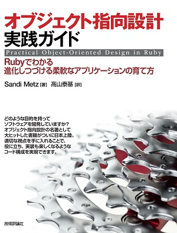
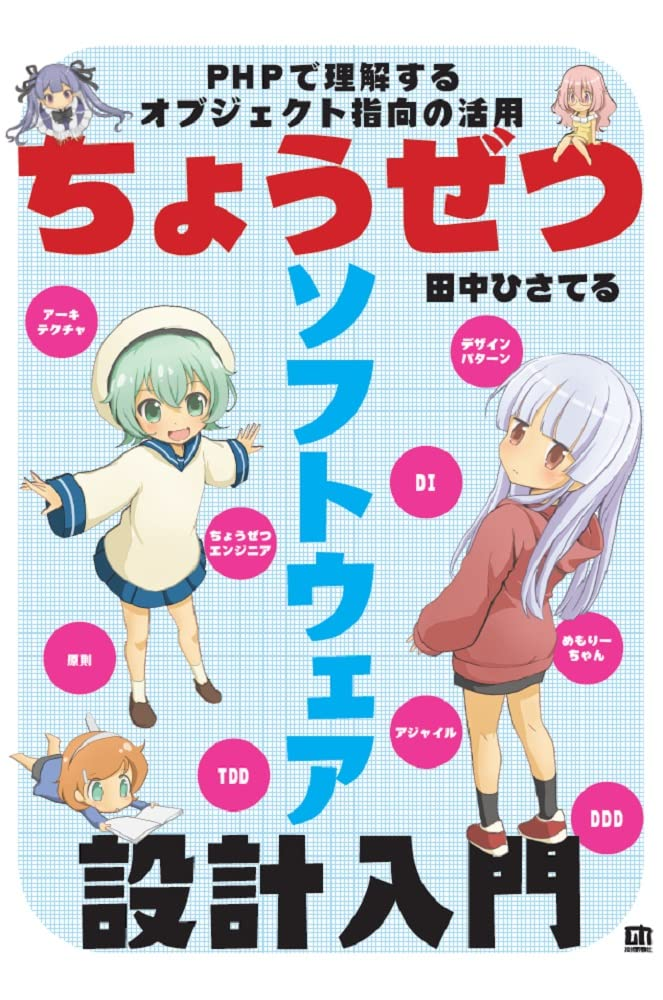
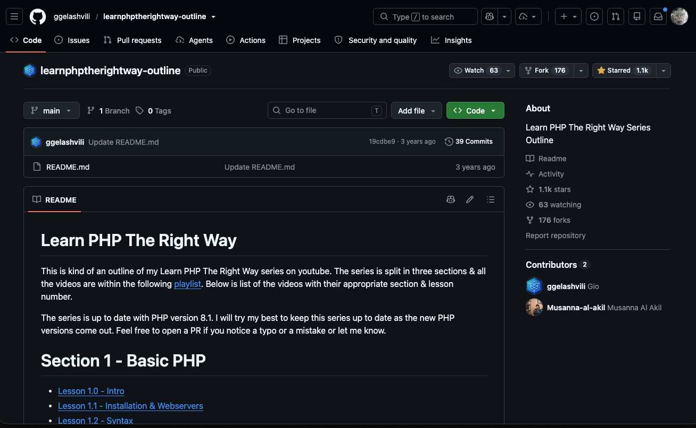

<style type="text/css">

@import url("https://fonts.googleapis.com/css2?family=M+PLUS+1p:wght@300;400;700&display=swap");
@import url("https://fonts.googleapis.com/css2?family=Source+Code+Pro:wght@300;400&display=swap");

:root {
  --r-background-color: white;
  --r-main-font: 'M PLUS 1p', sans-serif;
  --r-main-font-size: 28px;
  --r-main-color: #4d4c4b;
  --r-block-margin: 20px;
  --r-heading-margin: 0 0 20px 0;
  --r-heading-font: 'M PLUS 1p', sans-serif;
  --r-heading-color: #01a3c1;
  --r-heading-line-height: 1.5;
  --r-heading-letter-spacing: normal;
  --r-heading-text-transform: uppercase;
  --r-heading-text-shadow: none;
  --r-heading-font-weight: 700;
  --r-heading1-text-shadow: none;
  --r-heading1-size: 2.5em;
  --r-heading2-size: 2.0em;
  --r-heading3-size: 1.6em;
  --r-heading4-size: 1.2em;
  --r-code-font: 'Source Code Pro', monospace;
  --r-link-color: #42affa;
  --r-link-color-dark: #068de9;
  --r-link-color-hover: #8dcffc;
  --r-selection-background-color: rgba(66, 175, 250, 0.75);
  --r-selection-color: #4d4c4b;
  --r-overlay-element-bg-color: 240, 240, 240;
  --r-overlay-element-fg-color: 0, 0, 0;
}

.reveal h1,
.reveal h2,
.reveal h3,
.reveal h4,
.reveal h5,
.reveal h6 {
  text-transform: none;
}

.reveal p {
  line-height: initial;
  text-align: left;
}

.reveal pre {
  font-size: 0.6em;
}

ul {
  display: block;
  list-style: none;
  margin: 0 0 0 1.5em;
}

ul li::marker {
  content: '● ';
  font-size: 1em;
  color: #01a3c1;
}

ul li p {
  font-weight: bold;
}

ul li ul li::marker {
  content: '○ ';
  font-size: 1em;
  color: #01a3c1;
}

ul li ul li p {
  font-weight: normal;
}
</style>

# PHP に帰ってきました

<div style="text-align: right; font-size: 0.8em; margin-top: 20px;">
PHPカンファレンス愛媛2026 LT<br>
@msfukui
</div>

---

## 自己紹介

<div style="display: grid; grid-template-columns: 360px max-content; gap: 10px; align-items: start; justify-content: center;">


<div style="font-size: 0.9em;">

* 福井 将之 (ふくい まさゆき) @msfukui

* PHP を使った Web アプリケーション開発に従事

* 平日は東京、週末は山梨、たまに香川

* 車とバイクに乗ることと猫とキーボードが好きです

* PHP もとても好きです

</div>

</div>

---

## はじめに

* 2024 年に PHP を使った開発の現場に帰ってきて

* これまでを振り返って感じたことをお話ししてみます

* 10〜15 年ほど前からの昔話成分が多めです 🙇

* 注意: 生成AIを使った開発の話はいたしません

---

## 主なプログラミング言語との関わり

* 1998年〜2010年: C / Perl

* 2010年〜2015年: PHP(5.x)

* 2015年〜2020年: Ruby on Rails, JavaScript / Vue.js

* 2020年〜2023年: (インフラ関連業務に従事)

* 2024年〜: PHP(8.x) (現職)

---

## 昔の自分（PHP 5.x のころ）

* 独自の Web フレームワークっぽいもの

* サーバサイドのマルチページ構成 + Smarty

* 手続き型のコードが大半

* 初歩的な OOP の知識はあったが使い所はわからず

でもそれで満足していました、あるものを除いては..

---

## 「保守性」との闘い

* テストが書きにくい

    * リグレッションを確認する手段がない

    * バージョンアップのたびに全てを手動でテスト

    * 工数よりもまず、<ins>エンジニアとして気持ちがすり減っていく</ins>

* 抽象化ができない

    * C / Perl の CGI 由来の構造化設計の延長

    * 似た処理が重複し、コードベースが肥大化

    * 技術力が足りず、<ins>問題があることにすら気がつけない</ins>

Note: 構造化設計が問題を引き起こす理由の例: 「似ているけど少し違う、を分岐かコピーでしか表現できなかった」「処理が DB や各種のグローバル変数と直結していて、テストの継ぎ目がなかった」

---

## Rails を選ぶ

* あるプロダクトのリニューアルプロジェクトに参加

* PHP で行くか、別の選択肢を取るかを最初に議論

* 幾つかの選択から Ruby on Rails を選択

    * 個人的にはこの選択はよかったと思っています

---

## Rails で学んだこと

* テストを書く形があることの大切さ

    * どこでテストを書くか、どのように書くかの型がある

* 自分の書くコードをできるだけ小さく

    * 規約に従ってできるだけフレームワークに任せる

    * gem / bundler で自分が作るものを減らす

---

### 書籍で学ぶ

<div style="text-align: center;">
保守性のある OOP 設計を実感を持って学べた
</div>

<div style="display: grid; grid-template-columns: repeat(2, 1fr); gap: 10px; justify-items: center;">


</div>

---

## Web フロントエンドの開発と学び

* JavaScript / Vue.js を使った SPA の開発に参加

    * TypeScript が盛り上がり始めた頃だったが採用しなかった

* 純粋関数で処理を組み立て、状態操作は一か所に閉じ込める

* 宣言的に書き、条件分岐をできるだけ減らす

    * テストしやすく、バグが混入しにくいコードの書き方を学ぶ

---

## 帰る準備

<p style="text-align: center; font-weight: bold;">開発の現場から一旦離れ、その後現在の現場に</p>

<div style="text-align: center; font-size: 0.8em;">
事前に本とハンズオンで今の PHP の書き方を学ぶ
</div>

<div style="display: grid; grid-template-columns: repeat(2, 1fr); gap: 10px; justify-items: center;">


</div>

<div style="text-align: center; font-size: 0.8em;">
PHP の間口の広さのおかげか、数年離れていても、体に馴染んだと感じました
</div>

---

## PHP に帰ってきました

<div style="text-align: center;">
    <span style="background-color: yellow; font-weight: bold; padding: 10px;">全部ある！すごい！</span>
</div>

* 言語の型と OOP のサポートが大きく強化

* Composer による依存管理

* Web アプリケーションフレームワークの進化

* 開発支援のための周辺ツールが充実

* しかも、さらに漸進的な進化を続けている

---

### PHP の好きな言語機能

<div style="text-align: center;">
constructor property promotion / readonly class
</div>

```php
// Before
final class User
{
    private string $name;
    private int $age;

    public function __construct(string $name, int $age)
    {
        $this->name = $name;
        $this->age = $age;
    }
}
```

```php
// After
final readonly class User
{
    public function __construct(
        private string $name,
        private int $age,
    ) {}
}
```

Note: 最高です。古い書き方を見つけると全部直したくなる。 match / enum も常用。最近の機能も使い所を考えたい

---

### PHP の好きなところ

<div style="text-align: center;">
たくさんの人の総和で漸進的に進化する
</div>

* 後方互換性を考慮しつつ、少しずつ前に進む

* 時には貪欲に他の言語の成果も取り入れる

* 言語機能だけでなく、周辺のエコシステムも同様に

* プログラミング言語に関わるたくさんの人の取り組みや<br>意見が、収斂してより良い方向に進化している

Note: 他言語からの影響の例: constructor property promotion は構文を Hack から取り入れている。TypeScript や Kotlin にも似た仕組みがあり、いろいろな言語が同じ冗長さに悩んで、似た答えにたどり着いている。

---

## PHP に帰ってきて見えたこと

* 視野を広く持ち、自身やチームの技術力を高めることが、<br>プロダクトの保守性向上につながる、そこに近道はない

* プロダクトエンジニアの抱える課題は、保守性に限って<br>言えば、言語選択に起因することはあまり多くない

* とはいえ PHP は間口が広く、誰でも入ってこられて、<br>離れても比較的容易に帰ってこられる

* さらに今の PHP なら、もっとテストを書きやすく、<br>コードを小さく保つことができそう

Note: 間口が広い＝ C 系の見慣れた文法で、学び始めの人やほかの言語から来た人にも読みやすい。自分も C / Perl から入り、数年離れても本とハンズオンで帰ってこられた

---

# ありがとうございました 🙇

---

## 参考資料

* リファクタリング: Ruby エディション

    https://www.kadokawa.co.jp/product/201002000196/

* オブジェクト指向設計実践ガイド

    https://gihyo.jp/book/2016/978-4-7741-8361-9

* ちょうぜつソフトウェア設計入門

    https://gihyo.jp/book/2022/978-4-297-13234-7

* learnphptherightway-outline

    https://github.com/ggelashvili/learnphptherightway-outline

---

## 参考 RFC

* PHP RFC: Constructor Property Promotion

    https://wiki.php.net/rfc/constructor_promotion

* PHP RFC: Readonly properties 2.0

    https://wiki.php.net/rfc/readonly_properties_v2

* PHP RFC: Readonly classes

    https://wiki.php.net/rfc/readonly_classes

---

## Appendix: Before / After の例

* ECサイトの商品購入(会員ランク割引 + 送料)

----

### Before: 全て混ざった手続き型のコード

```php
function purchase(PDO $pdo, int $userId): void
{
    $stmt = $pdo->prepare('SELECT member_rank FROM users WHERE id = ?');
    $stmt->execute([$userId]);
    $rank = $stmt->fetchColumn();

    $subtotal = 0;
    foreach ($_SESSION['cart'] as $productId => $qty) {
        $stmt = $pdo->prepare('SELECT price FROM products WHERE id = ?');
        $stmt->execute([$productId]);
        $subtotal += $stmt->fetchColumn() * $qty;
    }

    if ($rank === 'gold') {
        $subtotal = (int) floor($subtotal * 0.9);
    } elseif ($rank === 'silver') {
        $subtotal = (int) floor($subtotal * 0.95);
    }
    $total = $subtotal + ($subtotal >= 5000 ? 0 : 500);

    $pdo->prepare('INSERT INTO orders (user_id, total) VALUES (?, ?)')
        ->execute([$userId, $total]);
    unset($_SESSION['cart']);
}
```

Note: 金額の計算を確かめたいだけなのに、DB とセッションが必要。ランクが増えるたびに elseif が増える。After では整数演算にして、浮動小数点の誤差を気にしなくてよくする(今回の実装では発生しないが、たとえば ceil(100 * 1.1) は 111 円になってしまう）

----

### After(1): ルールを型で表現

```php
enum MemberRank: string
{
    case Gold = 'gold';
    case Silver = 'silver';
    case Regular = 'regular';

    public function discountPercent(): int
    {
        return match ($this) {
            self::Gold => 10,
            self::Silver => 5,
            self::Regular => 0,
        };
    }
}

final readonly class LineItem
{
    public function __construct(
        public int $price,
        public int $quantity,
    ) {}
}
```

Note: ランクの追加は enum に case を足すだけ。match は網羅していないとエラーになるので、追加漏れに気づける

----

### After(2): 計算処理を副作用なしに

```php
final readonly class OrderCalculator
{
    private const FREE_SHIPPING_THRESHOLD = 5000;
    private const SHIPPING_FEE = 500;

    /** @param list<LineItem> $items */
    public function total(array $items, MemberRank $rank): int
    {
        $subtotal = array_sum(array_map(
            fn (LineItem $item) => $item->price * $item->quantity,
            $items,
        ));
        $discounted = intdiv($subtotal * (100 - $rank->discountPercent()), 100);
        $shipping = $discounted >= self::FREE_SHIPPING_THRESHOLD
            ? 0
            : self::SHIPPING_FEE;

        return $discounted + $shipping;
    }
}
```

Note: DB もセッションも触らない。同じ入力なら必ず同じ結果（Vue.js で学んだ純粋関数）。整数演算にして浮動小数点の誤差を気にしなくてよくなる

----

### After(3): サービスで手順を組み立てる

```php
final readonly class PurchaseService
{
    public function __construct(
        private CartRepository $carts,
        private UserRepository $users,
        private OrderRepository $orders,
        private OrderCalculator $calculator,
    ) {}

    public function purchase(int $userId): void
    {
        $items = $this->carts->itemsOf($userId);
        $rank = $this->users->rankOf($userId);
        $total = $this->calculator->total($items, $rank);

        $this->orders->save($userId, $total);
        $this->carts->clear($userId);
    }
}
```

Note: DB やセッションに触れるのはリポジトリだけ。サービスは手順を組み立てるだけ

----

### After(3)': インターフェースを定義

```php
interface CartRepository
{
    /** @return list<LineItem> */
    public function itemsOf(int $userId): array;
    public function clear(int $userId): void;
}

interface UserRepository
{
    public function rankOf(int $userId): MemberRank;
}

interface OrderRepository
{
    public function save(int $userId, int $total): void;
}
```

Note: インターフェースにしておくと、テストではメモリ上の偽物に差し替えられる。PurchaseService も DB なしでテストできる

----

### After(3)'': リポジトリの実装例

```php
final readonly class PdoUserRepository implements UserRepository
{
    public function __construct(private PDO $pdo) {}

    public function rankOf(int $userId): MemberRank
    {
        $stmt = $this->pdo->prepare('SELECT member_rank FROM users WHERE id = ?');
        $stmt->execute([$userId]);

        return MemberRank::from($stmt->fetchColumn());
    }
}
```
Note: この実装だと $userId が存在しない場合に MemberRank::from() が例外になるため、本来は $stmt->fetchColumn() の返却値の事前の確認が必要。CartRepository の実装では、セッションの商品 ID と数量から商品の価格を引いて LineItem を作る

----

### After(4): 計算処理をテスト

```php
use PHPUnit\Framework\Attributes\Test;
use PHPUnit\Framework\TestCase;

final class OrderCalculatorTest extends TestCase
{
    #[Test]
    public function ゴールド会員は10パーセント引きで送料無料(): void
    {
        $items = [new LineItem(price: 3000, quantity: 2)];
        $total = (new OrderCalculator())->total($items, MemberRank::Gold);

        $this->assertSame(5400, $total);
    }

    #[Test]
    public function 割引後に5000円未満なら送料がかかる(): void
    {
        $items = [new LineItem(price: 5000, quantity: 1)];
        $total = (new OrderCalculator())->total($items, MemberRank::Gold);

        $this->assertSame(5000, $total); // 4500 + 送料 500
    }
}
```

Note: DB もセッションも不要で、数ミリ秒で回る。バージョンアップのたびに手で確かめていた昔の自分に見せたい
