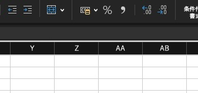

<style type="text/css">

@import url("https://fonts.googleapis.com/css2?family=M+PLUS+1p:wght@300;400;700&display=swap");
@import url("https://fonts.googleapis.com/css2?family=M+PLUS+1+Code:wght@400;700&display=swap");

:root {
  --r-background-color: white;
  --r-main-font: 'M PLUS 1p', sans-serif;
  --r-main-font-size: 28px;
  --r-main-color: #4d4c4b;
  --r-block-margin: 20px;
  --r-heading-margin: 0 0 20px 0;
  --r-heading-font: 'M PLUS 1p', sans-serif;
  --r-heading-color: #01a3c1;
  --r-heading-line-height: 1.5;
  --r-heading-letter-spacing: normal;
  --r-heading-text-transform: uppercase;
  --r-heading-text-shadow: none;
  --r-heading-font-weight: 700;
  --r-heading1-text-shadow: none;
  --r-heading1-size: 2.5em;
  --r-heading2-size: 2.0em;
  --r-heading3-size: 1.6em;
  --r-heading4-size: 1.2em;
  --r-code-font: 'M PLUS 1 Code', monospace;
  --r-link-color: #42affa;
  --r-link-color-dark: #068de9;
  --r-link-color-hover: #8dcffc;
  --r-selection-background-color: rgba(66, 175, 250, 0.75);
  --r-selection-color: #4d4c4b;
  --r-overlay-element-bg-color: 240, 240, 240;
  --r-overlay-element-fg-color: 0, 0, 0;
}

.reveal h1,
.reveal h2,
.reveal h3,
.reveal h4,
.reveal h5,
.reveal h6 {
  text-transform: none;
}

.reveal p {
  line-height: initial;
  text-align: left;
}

.reveal pre {
  font-size: 0.6em;
  tab-size: 4;
}

.reveal pre code {
  white-space: pre-wrap !important;
  overflow-wrap: anywhere;
}

.reveal .small-code pre {
  font-size: 0.48em;
}

.reveal .small-code pre code {
  max-height: none;
}

@media print {
  .reveal pre {
    box-shadow: none;
  }
}

ul {
  display: block;
  list-style: none;
  margin: 0 0 0 1.5em;
}

ul li::marker {
  content: '● ';
  font-size: 1em;
  color: #01a3c1;
}

ul li p {
  font-weight: bold;
}

ul li ul li::marker {
  content: '○ ';
  font-size: 1em;
  color: #01a3c1;
}

ul li ul li p {
  font-weight: normal;
}

ul ul {
  font-size: 0.8em;
}

ul ul ul {
  font-size: 1em;
}
</style>

# PHPのインクリメント機能の不思議

<div style="text-align: right; font-size: 0.8em; margin-top: 20px;">
PHPCon Niigata 2026 LT<br>
@msfukui
</div>

---

## 自己紹介

<div style="display: grid; grid-template-columns: 360px max-content; gap: 10px; align-items: start; justify-content: center;">


<div style="font-size: 0.9em;">

* 福井 将之 (ふくい まさゆき) @msfukui

* PHP を使った Web アプリケーション開発に従事

* 平日は東京、週末は山梨、たまに香川

* 車とバイクに乗ることと猫とキーボードが好きです

* PHP もとても好きです

</div>

</div>

---

## 三行で

- PHP では 'Z' を ++ でインクリメントすると 'AA'

- でも 'AA' を -- でデクリメントしても 'AA' のまま

- 不思議に思って少し調べてみた

- というだけのお話をしてみます

---

## 経緯

- 過去とある Excel ファイルを出力する PHP のコードを書いていて

- Excel の列番号は 'Z' の次は 'AA'

    

- こいつ..動くぞ！

<div style="padding: 0.8em; text-align: center; font-size: 0.8em;">
PHP 8.3 から非推奨となったこともあって、実際は採用しませんでしたが
</div>

---

## 文字列のインクリメント

```php
$s = 'a';  $s++; // 'b'
$s = 'z';  $s++; // 'aa'
$s = 'Az'; $s++; // 'Ba'
$s = 'Zz'; $s++; // 'AAa'
$s = 'a9'; $s++; // 'b0'
$s = '';   $s++; // '1'
```

* 英小文字・英大文字・数字が、それぞれの範囲で繰り上がる

* 桁があふれたら、先頭の文字の種類で 1 桁増える

* 日本語や記号など英数字以外の文字があるとそこで繰り上がりが止まる

* 空文字だけは文字列の 1 に

---

## 文字列のデクリメント

```php
$s = 'b';   $s--; // 'b'
$s = 'aa';  $s--; // 'aa'
$s = 'Ba';  $s--; // 'Ba'
$s = 'AAa'; $s--; // 'AAa'
$s = 'b0';  $s--; // 'b0'
$s = '';    $s--; // -1
```

* 繰り下がりはなく、値は変わらない

* 空文字だけは数値の -1 に

---

## なんだか不思議

---

## 実装を眺めてみます

---

## PHP での概観

* PHP/FI 2.0.1

  * atol() で数値変換して +1、前置(++$a) は構文エラー

* PHP 3.0 - PHP 8.2

  * 今回の繰り上がり処理が入り、そのまま継続

* PHP 8.3

  * 空文字・英数字以外が含まれる文字列の ++ は deprecated に

  * `str_increment()`, `str_decrement()` が追加

* PHP 8.5

  * 数値でない文字列の ++ はすべて deprecated に

---

## PHP 8 での処理の流れ

* `Zend/zend_compile.c`

  * `$a++` を `ZEND_POST_INC` にコンパイル

* `Zend/zend_vm_def.h` の `ZEND_POST_INC` ハンドラ

  * 整数ならその場で +1、それ以外は `zend_post_inc_helper` へ

* `Zend/zend_operators.c` の `increment_function()` を呼び出し

---

### PHP 8.2: increment_function()

<div style="font-size: 0.5em; text-align: left;"><a href="https://github.com/php/php-src/blob/php-8.2.35/Zend/zend_operators.c#L2499-L2524">Zend/zend_operators.c#L2499-L2524 (php-8.2.35)</a></div>

```c
		case IS_NULL:
			ZVAL_LONG(op1, 1);
			break;
		case IS_STRING: {
				zend_long lval;
				double dval;

				switch (is_numeric_str_function(Z_STR_P(op1), &lval, &dval)) {
					case IS_LONG:
						...
						break;
					case IS_DOUBLE:
						...
						break;
					default:
						/* Perl style string increment */
						increment_string(op1);
						break;
```

<div style="font-size: 0.8em; text-align: center;">
    型ごとに switch、数値以外の文字列なら <code>increment_string()</code> を呼び出し
</div>

Note: この「数値以外の文字列」の判定がなかなかまた興味深いのですが今回は割愛します

---

### PHP 8.2: increment_string() 1/2

<div style="font-size: 0.5em; text-align: left;"><a href="https://github.com/php/php-src/blob/php-8.2.35/Zend/zend_operators.c#L2411-L2415">Zend/zend_operators.c#L2411-L2415 (php-8.2.35)</a></div>

```c
	if (Z_STRLEN_P(str) == 0) {
		zval_ptr_dtor_str(str);
		ZVAL_CHAR(str, '1');
		return;
	}
```

<div style="font-size: 0.8em; text-align: center; padding-bottom: 1em;">
    空文字の場合は、文字列の '1' を返す
</div>

---

### PHP 8.2: increment_string() 2/2

<!-- .slide: class="small-code" -->

<div style="font-size: 0.5em; text-align: left;"><a href="https://github.com/php/php-src/blob/php-8.2.35/Zend/zend_operators.c#L2430-L2466">Zend/zend_operators.c#L2430-L2466 (php-8.2.35)</a></div>

```c
	do {
		ch = s[pos];
		if (ch >= 'a' && ch <= 'z') {
			if (ch == 'z') {
				s[pos] = 'a';
				carry=1;
			} else {
				s[pos]++;
				carry=0;
			}
			last=LOWER_CASE;
		} else if (ch >= 'A' && ch <= 'Z') {
			...
		} else if (ch >= '0' && ch <= '9') {
			...
		} else {
			carry=0;
			break;
		}
		if (carry == 0) {
			break;
		}
	} while (pos-- > 0);
```

<div style="font-size: 0.8em; text-align: center;">
    文字列末尾から 1 文字ずつ見て、文字種ごとに繰り上げている
</div>

---

### ちなみに decrement_function() だと

<div style="font-size: 0.5em; text-align: left;"><a href="https://github.com/php/php-src/blob/php-8.2.35/Zend/zend_operators.c#L2567-L2588">Zend/zend_operators.c#L2567-L2588 (php-8.2.35)</a></div>

```c
		case IS_STRING:		/* Like perl we only support string increment */
			if (Z_STRLEN_P(op1) == 0) { /* consider as 0 */
				zval_ptr_dtor_str(op1);
				ZVAL_LONG(op1, -1);
				break;
			}
			switch (is_numeric_str_function(Z_STR_P(op1), &lval, &dval)) {
				case IS_LONG:
					...
					break;
				case IS_DOUBLE:
					...
					break;
			}
			break;
```

<div style="font-size: 0.8em; text-align: center;">
    <code>default:</code> がないので、数値でない文字列は何もせずそのまま
</div>

---

## なお Perl だと

<div style="display: grid; grid-template-columns: repeat(2, 1fr); gap: 5px;">

```perl
$s = 'a';  $s++; # 'b'
$s = 'z';  $s++; # 'aa'
$s = 'Az'; $s++; # 'Ba'
$s = 'Zz'; $s++; # 'AAa'
$s = 'a9'; $s++; # 'b0'
$s = '';   $s++; # 1
```

```perl
$s = 'b';   $s--; # -1
$s = 'aa';  $s--; # -1
$s = 'Ba';  $s--; # -1
$s = 'AAa'; $s--; # -1
$s = 'b0';  $s--; # -1
$s = '';    $s--; # -1
```

</div>

<div style="padding: 1.0em;">

* インクリメントの挙動に若干の違いがある(後述)

    * 空文字のインクリメントは文字列ではなく数値の 1

    * '9z' は PHP では '10a'、Perl では 10

* デクリメントは全て -1

</div>

---

### 遡ると

Perl 2.0 (1988年) のマニュアルから:
<span style="font-size: 0.5em;"><a href="https://github.com/Perl/perl5/blob/perl-2.0/perl.man.1#L1037-L1052">perl.man.1#L1037-L1052 (perl-2.0)</a></span>

> The autoincrement operator has a little extra built-in magic to it. ...
> The autodecrement is not magical.

* 以後最新の Perl 5.44.0 (2026-07-15 リリース) まで挙動は変わらず

    * Perl 1.0 では異なる実装がされていますが一旦ここでは割愛します..

---

### Perl: sv.c の Perl_sv_inc_nomg()

<div style="font-size: 0.5em; text-align: left;">
<a href="https://github.com/Perl/perl5/blob/v5.44.0/sv.c#L10219-L10286">sv.c#L10219-L10286 (perl v5.44.0)</a><br>
(抜粋して一部を取り除いて再構成)
</div>

```c
d = SvPVX(sv);
while (isALPHA(*d)) d++;     // /^[a-zA-Z]*[0-9]*$/ に
while (isDIGIT(*d)) d++;     // 合わなければ数値として +1
...
while (d >= SvPVX_const(sv)) {
    if (isDIGIT(*d)) {
        if (++*d <= '9') return;
        *(d--) = '0';
    } else {
        ++*d;
        if (isALPHA(*d)) return;
        *(d--) -= 'z' - 'a' + 1;
    }
}
/* oh,oh, the number grew */
```

<div style="font-size: 0.8em; text-align: center;">
    微妙に PHP の実装と違う..
</div>

---

### PHP と Perl のアルゴリズムの違い

* 書き方は違うけれど、ループの中は一緒

* 入力値の受け入れ方に違いがある

    * PHP は数値でなければ文字列として扱う

    * Perl は `/^[a-zA-Z]*[0-9]*$/` に合わなければ数値変換して +1

* '9z' の場合

    * PHP では `'10a'`, Perl では `9 + 1` → `10`

* 'A9z' の場合

    * PHP では `'B0a'`, Perl では `0 + 1` → `1`

---

## 改めて PHP に戻って<br>PHP 8.3 以降も眺めてみる

---

### PHP 8.3: increment_string() 1/2

<div style="font-size: 0.5em; text-align: left;"><a href="https://github.com/php/php-src/blob/php-8.3.36/Zend/zend_operators.c#L2523-L2532">Zend/zend_operators.c#L2523-L2532 (php-8.3.36)</a></div>

```c
	if (UNEXPECTED(Z_STRLEN_P(str) == 0)) {
		zend_error(E_DEPRECATED, "Increment on non-alphanumeric string is deprecated");
		if (EG(exception)) {
			return false;
		}
		/* A userland error handler can change the type from string to something else */
		zval_ptr_dtor(str);
		ZVAL_CHAR(str, '1');
		return true;
	}
```

<div style="font-size: 0.8em; text-align: center; padding-bottom: 1em;">
    空文字の場合は、警告を出して文字列の '1' を返す
</div>

---

### PHP 8.3: increment_string() 2/2

<div style="font-size: 0.5em; text-align: left;"><a href="https://github.com/php/php-src/blob/php-8.3.36/Zend/zend_operators.c#L2534-L2544">Zend/zend_operators.c#L2534-L2544 (php-8.3.36)</a></div>

```c
	if (UNEXPECTED(!zend_string_only_has_ascii_alphanumeric(Z_STR_P(str)))) {
		zend_string *zstr = Z_STR_P(str);
		zend_string_addref(zstr);
		zend_error(E_DEPRECATED, "Increment on non-alphanumeric string is deprecated");
		if (EG(exception)) {
			zend_string_release(zstr);
			return false;
		}
		zval_ptr_dtor(str);
		ZVAL_STR(str, zstr);
	}
```

<div style="font-size: 0.8em; text-align: center;">
    英数字以外を含む文字列の場合は、警告を出して処理は継続<br>
    後続の判定条件は PHP8.2 からほぼ変更なし
</div>

---

### PHP 8.5 / 8.6: increment_string()

<div style="font-size: 0.5em; text-align: left;"><a href="https://github.com/php/php-src/blob/php-8.5.12/Zend/zend_operators.c#L2622-L2628">Zend/zend_operators.c#L2622-L2628 (php-8.5.12)</a></div>

```c
	zend_string *zstr = Z_STR_P(str);
	zend_string_addref(zstr);
	zend_error(E_DEPRECATED, "Increment on non-numeric string is deprecated, use str_increment() instead");
	if (EG(exception)) {
		zend_string_release(zstr);
		return false;
	}
```

<div style="font-size: 0.8em; text-align: center;">
    冒頭で無条件に警告を出して処理は継続<br>
    数値でない文字列は一律で警告対象に<br>
    後続の判定条件は PHP8.2, PHP8.3 からほぼ変更なし<br>
    PHP 8.6 (8.6.0RC7) でも実装は変更なし
</div>

---

### 代替実装: str_increment() 1/2

<div style="padding-bottom: 1.0em; text-align: center;">
    既存の <code>increment_string()</code> とは別実装
</div>

<div style="font-size: 0.5em; text-align: left;"><a href="https://github.com/php/php-src/blob/php-8.5.12/ext/standard/string.c#L1283-L1290">ext/standard/string.c#L1283-L1290 (php-8.5.12)</a></div>

```c
	if (ZSTR_LEN(str) == 0) {
		zend_argument_must_not_be_empty_error(1);
		RETURN_THROWS();
	}
	if (!zend_string_only_has_ascii_alphanumeric(str)) {
		zend_argument_value_error(1, "must be composed only of alphanumeric ASCII characters");
		RETURN_THROWS();
	}
```

<div style="font-size: 0.8em; text-align: center;">
    空文字を含めて英数字以外を <code>ValueError</code> にする厳密な実装
</div>

---

### 代替実装: str_increment() 2/2

<!-- .slide: class="small-code" -->

<div style="font-size: 0.5em; text-align: left;"><a href="https://github.com/php/php-src/blob/php-8.5.12/ext/standard/string.c#L1292-L1310">ext/standard/string.c#L1292-L1310 (php-8.5.12)</a></div>

```c
	zend_string *incremented = zend_string_init(ZSTR_VAL(str), ZSTR_LEN(str), /* persistent */ false);
	size_t position = ZSTR_LEN(str)-1;
	bool carry = false;

	do {
		char c = ZSTR_VAL(incremented)[position];
		/* We know c is in ['a', 'z'], ['A', 'Z'], or ['0', '9'] range from zend_string_only_has_ascii_alphanumeric() */
		if (EXPECTED( c != 'z' && c != 'Z' && c != '9' )) {
			carry = false;
			ZSTR_VAL(incremented)[position]++;
		} else { /* if 'z', 'Z', or '9' */
			carry = true;
			if (c == '9') {
				ZSTR_VAL(incremented)[position] = '0';
			} else {
				ZSTR_VAL(incremented)[position] -= 25;
			}
		}
	} while (carry && position-- > 0);
```


<div style="font-size: 0.8em; text-align: center;">
    ループの挙動は同じだが、入力が厳密になった分、書き方はすっきりしている
</div>

---

## おもしろっ！

---

### おまけ: なぜ Excel の列は Z の次が AA ?

<div style="font-size: 0.7em;">

* 起源は 1979年の表計算ソフト VisiCalc (らしい)

    列は 63 (A〜BK)、行は 255

    > "We departed from common notation by numbering the rows and using letters for the columns. This was because we had only 63 columns and 255 rows."

* この A1 方式が Lotus 1-2-3 を経て Excel の標準になった

* 数学的には 0 のない「全単射 26 進法」(A=1 … Z=26)

* ちなみに最後の列は VisiCalc `BK` (63) → Excel `IV` (256) → Excel 2007〜 `XFD` (16,384)

* なお、PHP で `'A'` から 16,383 回 `++` すると、ちゃんと `'XFD'` になります

</div>

Note: 列数を 63 にしたのは「1 年分の生産計画に十分な列と少しの余り」(Frankston)。63 = 2^6-1、255 = 2^8-1 なのでビット数を抑えたと読めるが、それは推測。AA, AB... という数え方を選んだ理由そのものを語った資料は見つからなかった。0 がないので B0 のような書き方がなく、Z の次は AA になる。PHP の英字の繰り上げ(Perl 由来)は英字だけなら全単射 26 進法の +1 そのものなので、Excel の列名がそのまま作れる(PHP 8.2 で 27=AA, 63=BK, 256=IV, 16384=XFD を確認)。Perl が表計算ソフトを参考にしたという資料はない。

---

# ありがとうございました 🙇

---

## 参考

---

### 参考資料 1/4

<div style="font-size: 0.8em;">

* PHP RFC: Path to Saner Increment/Decrement operators

    https://wiki.php.net/rfc/saner-inc-dec-operators

* PHP RFC: Deprecations for PHP 8.5

    https://wiki.php.net/rfc/deprecations_php_8_5

* PHP Manual: Incrementing/Decrementing Operators

    https://www.php.net/manual/en/language.operators.increment.php

* php/php-src (GitHub)

    https://github.com/php/php-src

</div>

---

### 参考資料 2/4

<div style="font-size: 0.8em;">

* perlop: Auto-increment and Auto-decrement

    https://perldoc.perl.org/perlop#Auto-increment-and-Auto-decrement

* Perl 2.0 (1988年) のマニュアル perl.man.1

    https://github.com/Perl/perl5/blob/perl-2.0/perl.man.1

* Perl/perl5 (GitHub)

    https://github.com/Perl/perl5

* PHP Museum (PHP/FI 2.0.1, PHP 3.0 の配布物)

    https://museum.php.net/

* farwish/php2: PHP/FI 2.0.1 のソースのミラー (GitHub)

    https://github.com/farwish/php2

</div>

---

### 参考資料 3/4

<div style="font-size: 0.8em;">

* Implementing VisiCalc (Bob Frankston, 2003)

    https://www.landley.net/history/mirror/apple2/implementingvisicalc.html

* Was VisiCalc the "first" spreadsheet? (Dan Bricklin)

    http://www.bricklin.com/firstspreadsheetquestion.htm

* 表計算ソフト誕生の話 (Dan Bricklin, TEDxBeaconStreet 2016 / 青木靖 訳)

    https://aoky.net/articles/dan_bricklin/meet_the_inventor_of_the_electronic_spreadsheet.htm

</div>

---

### 参考資料 4/4

<div style="font-size: 0.8em;">

* Multiplan - Wikipedia

    https://en.wikipedia.org/wiki/Multiplan

* Excel column numbering (John D. Cook)

    https://www.johndcook.com/blog/2026/07/25/excel-column-numbering/

* Excel specifications and limits (Microsoft)

    https://support.microsoft.com/en-us/office/excel-specifications-and-limits-1672b34d-7043-467e-8e27-269d656771c3

</div>

---

### メモ: PHP/FI 2.0.1: ++ が実行されるまで

<div style="font-size: 0.7em;">

1. `src/lex.c`: `++` を `INC` トークンに ([L1266-L1270](https://github.com/farwish/php2/blob/f160321dc17b46e602195ff353fbbb1dcecf8a80/src/lex.c#L1266-L1270))
2. `src/parse.raw` (yacc): `expr INC` の規則で `CalcInc()` を直接呼ぶ ([L522-L525](https://github.com/farwish/php2/blob/f160321dc17b46e602195ff353fbbb1dcecf8a80/src/parse.raw#L522-L525))
3. `src/calc.c` の `CalcInc()`: 文字列も数値と同じ分岐で +1 ([L202-L208](https://github.com/farwish/php2/blob/f160321dc17b46e602195ff353fbbb1dcecf8a80/src/calc.c#L202-L208))

</div>

```c
	| expr INC
		{
			if(GetCurrentState(NULL) || inCase || inElseIf) CalcInc(INC);
		}
```

```c
	switch(s->type) {
		case LNUMBER:
		case STRING:
			switch(op) {
				case INC:
					s->intval++;
					sprintf(temp,"%ld",s->intval);		
```

<div style="font-size: 0.7em;">

* opcode へのコンパイルや VM はなく、構文解析しながらその場で実行

* `intval` は `atol()` で文字列から変換した値 ([src/stack.c#L88](https://github.com/farwish/php2/blob/f160321dc17b46e602195ff353fbbb1dcecf8a80/src/stack.c#L88))

</div>

Note: 'a' や 'z' は atol() で 0 になるので、++ すると数値の 1 になる。後置の $a++ の規則しかなく、前置の ++$a だと文法エラーになる。
